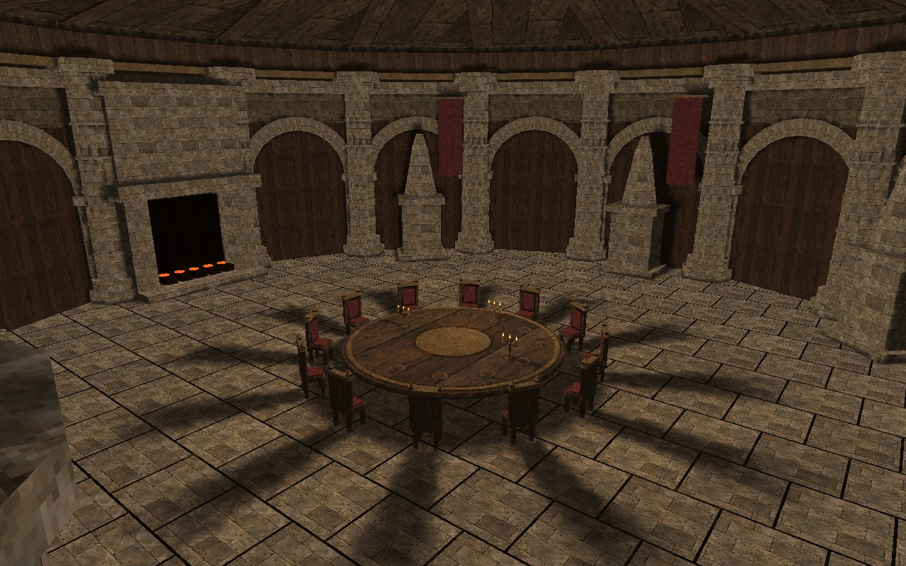

# Survivors Roundtable hub

The Survivors hub and its title scene use an original, simplified interpretation
of the Roundtable Hold: a sixteen-sided stone hall, round walnut table, twelve
high-backed chairs, carved arches, drum columns, a ribbed ceiling, burgundy
banners, stylized memorials and a west-wall fireplace. This is new geometry and
an original generated material atlas, not extracted Elden Ring assets.



This preview renders the shipped mesh and texture. It is **not an in-game
screenshot**: Link, Zelda, the equipment chest and the floating golden flame
are added by the game. The former central ceremonial bowl has been removed. Fireplace fire
and point lighting are native effects; candle flames and coals are simple mesh
details. The hall combines baked vertex lighting with a static soft-shadow lightmap
cast from the central flame onto the floor, furniture and architecture. These
shadows follow the fixed light position, not individual moving particles.

## Layout and integration

- Main hall radius: 1,800 game units (the compact build-1295 layout); floor:
  Y = -400. The south approach reaches
  the existing doorway at Z = 3,900 / Y = -250 via a gentle ramp.
- The table is centered at X/Z = 0, with twelve chairs, including the front row.
  Link rests at Z = 760, outside the chair ring; Zelda stands at X = -650 and
  faces the centre. The title camera follows the relocated rest position.
  Zelda's sword gift, talents and exit warning remain intact.
- A tall golden native flame with sparks floats above the tabletop at Y = -220.
  Its warm point light is centered at Y = -50. Five light samples bake soft
  shadows from the actual visible geometry into a 1024×1024 I8 lightmap;
  collision-only furniture proxies do not cast artificial box shadows.
  Ambient light remains visible within shadows. The hearth retains its fire.
- The table is 100.5 units high and 361.8 units in radius; chair seats are
  72.05 units high (including cushions) and the full chair height is 187. Table settings and smaller
  candle holders sit on the tabletop. Memorial plinths extend to the floor.
- Floor brightness is explicitly 255 (inherit native room lighting), rather
  than 0, which multiplies actor ambient light to zero. This fixes the black
  Link silhouette away from point lights without changing global lighting.
  Warmer, brighter baked wall lighting retains visible wood in the recesses;
  planar flagstone UVs remove diagonal seams on clipped floor tiles.
- A 600-unit-deep stone reveal encloses the native door frame at Z = 3,900
  and joins both corridor walls and the ceiling. Solid wings, a lintel and a visible back wall replace the
  freestanding shutter/black void; its approach and native event goals stay clear.
- Recessed wall panels and arch pilasters collide at their visible front faces.
  The table has a continuous collision skirt to the floor, and chairs have
  full seat/body and back volumes. These cover Link's native +30.01-unit wall
  check, which previously passed below the tabletops/seats between thin legs.
  The upper collision surfaces match the tabletop and chair cushion heights.
- Wall and column textures repeat every 200 world units; shaft UVs wrap around
  the circumference. Repeats are split into triangles before export, with atlas
  padding to prevent sampling adjacent materials or reserved emissive texels.
  The collider retains unsplit surfaces and does not grow with texture repeats.
- The equipment chest still probes the east wall. Collision tests cover its
  approach, Zelda's position, the rest position and the route to the exit.
- Only completed room-51 BG actors created for the Survivors hub/title acquire
  the replacement. Their actor IDs retain ownership until deletion; switching
  game modes cannot convert outgoing rooms or normal combat rooms.
- Native stage props are filtered for this hub; the original door actors and
  scene infrastructure stay. Standalone hub decorations are unaffected.
- New collision surfaces explicitly carry no native room-camera/path references,
  preventing them from selecting camera or path record zero of the dungeon.
- Original archive data and native room models remain untouched. Native room
  creation completes first; a private native DZB replaces its registered
  collision atomically. A custom J3D packet renders the hall. Missing resources,
  allocation failure or a full collision registry leave the original room.
- Deletion restores native pointers/registration before native cleanup. Disabling
  the mod also restores the original room; no custom collider vtable or particle
  callback remains attached. Draw packets are removed before their storage dies.

The normal **Darknut Arena combat map** keeps its original geometry. No touch UI,
save format, item reward or title input timing is changed.

## Reproduction

```sh
python3 tools/generate_roundtable.py --texture tools/assets/roundtable_materials.png
python3 tools/bake_roundtable_shadows.py
python3 tests/survivors_roundtable_test.py
python3 tests/survivors_roundtable_shadows_test.py
python3 tests/survivors_roundtable_runtime_test.py
CXX=clang++ python3 tests/survivors_roundtable_runtime_test.py
python3 tools/preview_roundtable.py /tmp/roundtable.png
```

The generator emits a little-endian vertex stream, big-endian native DZB and a
256×256 tiled RGB565 atlas. The shadow baker needs NumPy and a C++20 compiler;
its output is a GX-tiled I8 lightmap with a second UV set in the RTH2 mesh. Geometry generation and tests need only Python's
standard library; texture conversion needs Pillow and the optional preview
needs Pillow plus NumPy. Assets are checked in, so builds never need generation
tools or network image generation. There are 26,539 visual triangles and 5,218
collision triangles, with a balanced collision tree. Resources total about 3.7 MiB
and are cached until mod shutdown; each live room uses a private 2 MiB heap.

The runtime fixture executes the production implementation with a fake host,
ASan/UBSan and both compilers: partial/failed creation, 30 room lifetimes,
selection changes, repeated retained draws, native particle/light cleanup,
deletion and mod shutdown. Geometry tests verify reproducibility, native table
bounds/tree ancestry, winding, inherited floor lighting, furniture heights,
grounded memorial plinths, front-facing wall/seat/table blocking at native
body-check heights, clear door-event paths and uniform wall/column UV density.
The runtime test checks that every vertex is submitted across multiple GX batches.
Shadow tests validate source/asset fingerprints, intensity range, the atlas format,
ray occlusion, double-sided blockers and self-shadow bias.

In-game visual and native-door validation still requires a playable installation:
load a new/existing save, finish Zelda's gift, open talents/equipment, start each
run map and return, repeatedly switch Play/Survivors, then check both the moving
title camera and the 0.7-second save arrival. The offline preview and fake-host
tests cannot establish the exact appearance or door-event timing on a device.

## Material source

Image generation mode: new opaque image. The checked-in source is a 256×256
downsample of the generated atlas; `materials.rgb565` is its mechanical encoding.
Prompt:

> Create an original game environment material texture atlas, square 1024x1024
> image, opaque. Exactly four equally sized square quadrants, no gaps or frames.
> Top-left: warm grey-brown worn medieval limestone ashlar blocks with subtle
> fine cracks, joints, rough pores. Top-right: dark aged walnut wood grain,
> boards, restrained scratches, no furniture. Bottom-left: muted deep burgundy
> woven cloth, slightly faded, evenly spread weave, no folds. Bottom-right:
> aged warm bronze metal surface, delicate engraved concentric scrolls, gentle
> patina. Each quadrant perfectly flat orthographic material scan, no
> perspective, no cast shadows, no directional highlights, diffuse albedo only.
> Consistent low contrast, natural realistic painted game texture, muted warm
> palette, no letters, no text, no objects, no logos. These textures will be
> tiled over a newly authored low-poly medieval fantasy hall.
