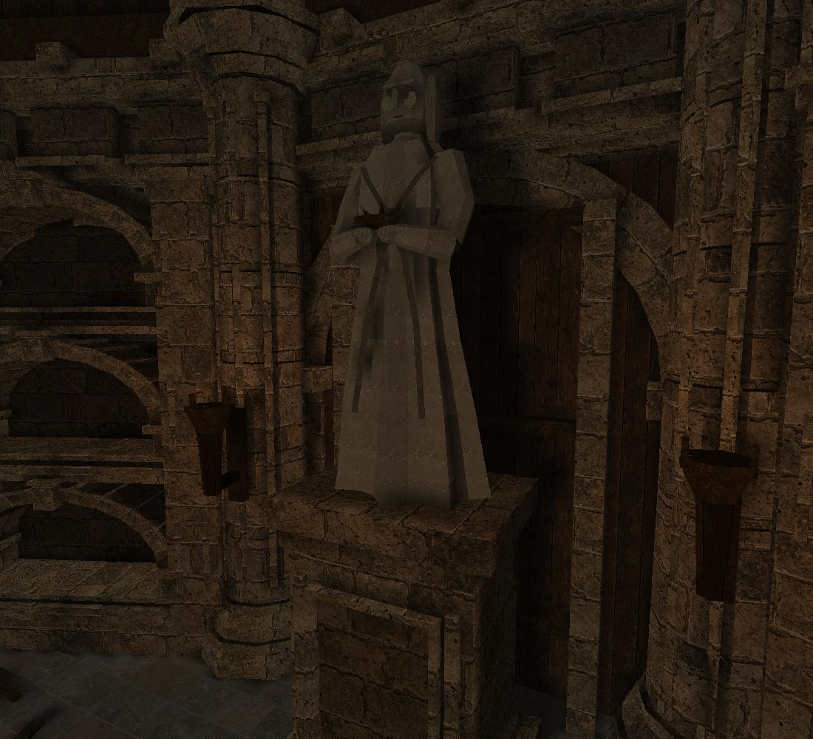
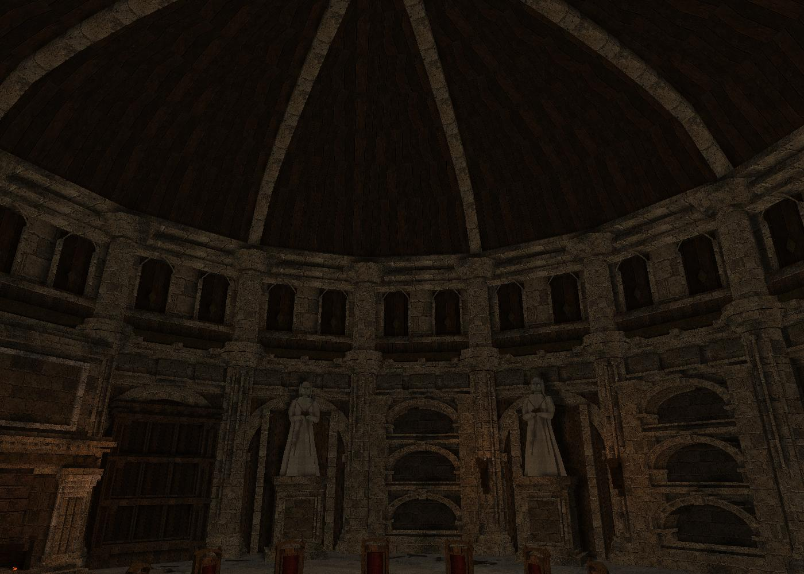
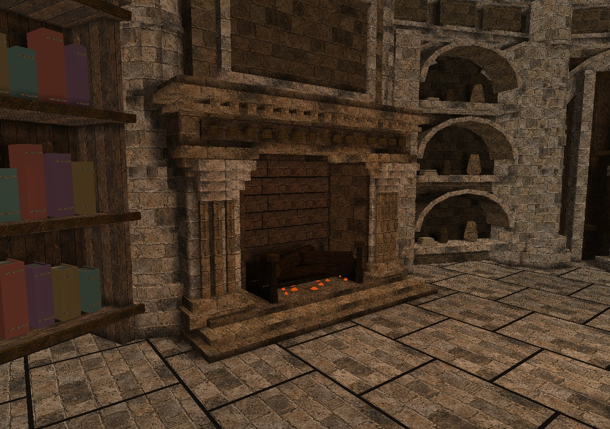
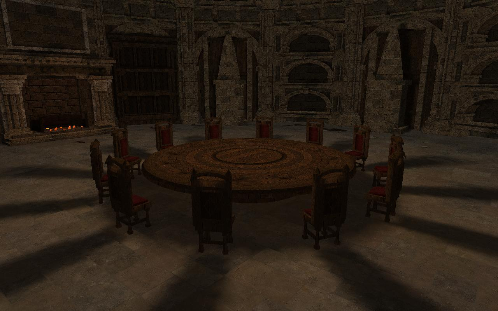
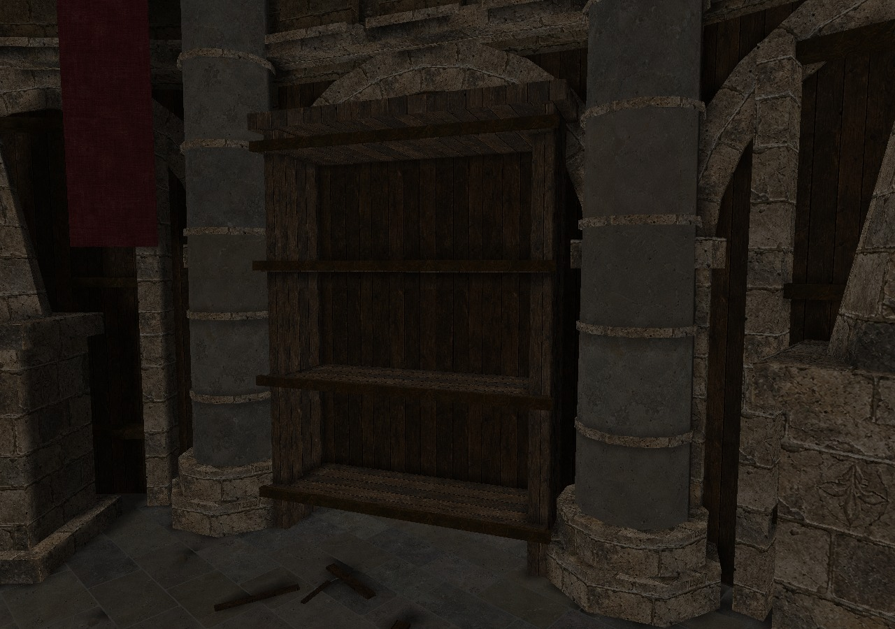
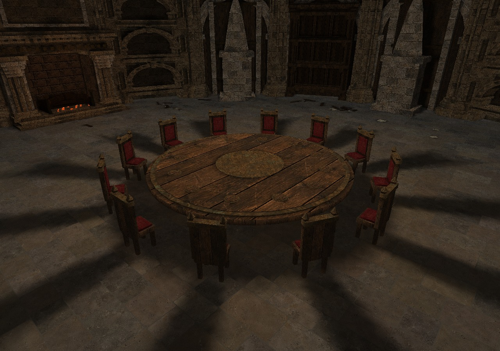
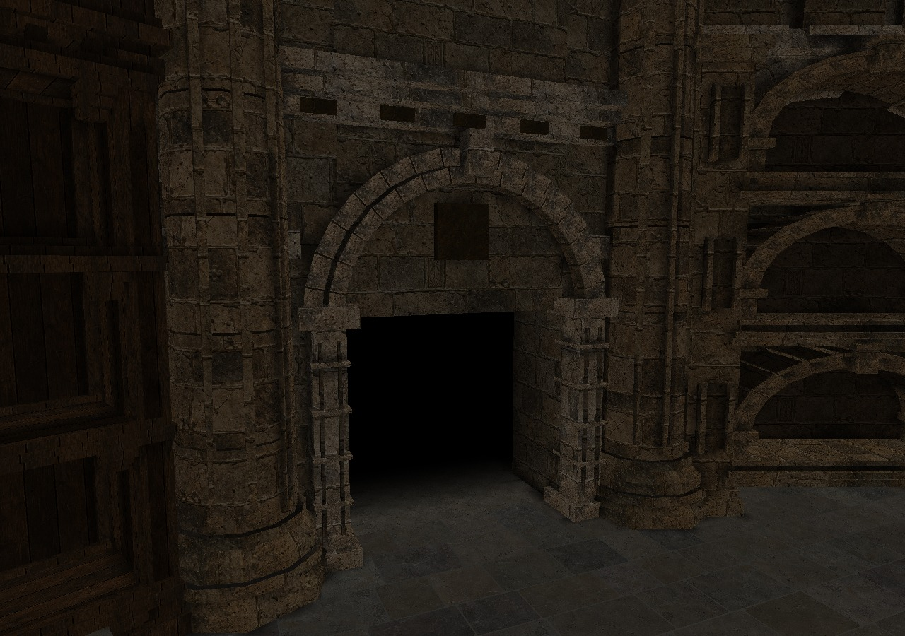

# Survivors Roundtable hub

The Survivors hub and its title scene use an original, simplified interpretation
of the Roundtable Hold: a sixteen-sided stone hall, round walnut table, twelve
high-backed chairs, carved arches, drum columns, a ribbed ceiling, stylized
robed memorial figures and a west-wall fireplace. Ceiling banners and their rods are removed. This is new geometry and
an original generated material atlas, not extracted Elden Ring assets.


This preview renders the shipped mesh and texture. It is **not an in-game
screenshot**: Link, Zelda, the equipment chest and the floating golden flame
are added by the game. The former central ceremonial bowl has been removed. Fireplace fire
and point lighting are native effects; coals are simple mesh details. The handmade
table candle holders have been removed, leaving the floating centre flame. The hall combines baked vertex lighting with a static soft-shadow lightmap
cast from the central flame and weaker fireplace onto the floor, furniture and
architecture. These shadows follow the fixed lights, not individual moving particles.

## Sculptures, torchlight and raised vault

Three original stone figures replace the pointed memorial placeholders. Each has
an oval face, carved brows/nose/eyes, side hair or cowl, bent sleeves, cupped hands
and a small bronze votive bowl. Deep asymmetric robe folds and raised mantle seams
break up the silhouette. The existing grounded plinth positions remain.



The eaves rise from 1,180 to 1,660 units above the floor; the crown rises from
1,510 to 2,250. Eight curved stone ribs support the timber vault. Extended piers,
layered capitals, cornice bands and paired recessed clerestory panels with pointed
arches and bronze leaf motifs continue the fireplace's restrained palette.



Six paired inward-facing pier sconces use the actual `Obj_Lv2Candle` native
simple-particle trio (`0x100`, `0x101`, `0x103`) used by `L4candl` in Arbiter's
Grounds. Their metal brackets and baskets are authored room geometry; fire,
smoke and sparks are native. Every source registers a local 500-unit warm point
light for native actors. The room bake includes their weaker, occluded light
contribution with a 550-unit falloff. The central flame remains dominant.
The two piers immediately beside the west fireplace have no sconces, fire effects
or torch lights; the fireplace supplies their local illumination.
Simple effects are submitted per update and naturally expire; all six point
lights are removed with the room, alongside the existing two fire lights and
18 persistent central/hearth emitters. No global cutscene or UI state is changed.

These offline images omit native particles and actors. Device verification is
still needed for flame appearance and actual performance.

## Layout and integration

- Main hall radius: 1,800 game units (the compact build-1295 layout); floor:
  Y = -400. The exit now sits directly at the south hall edge,
  Z = 1815.4135 / Y = -400. The long rising corridor is removed.
- The table is centered at X/Z = 0, with twelve chairs, including the front row.
  Link rests at Z = 760, outside the chair ring; Zelda stands diagonally in front of the west fireplace at X/Z = -1170/430
  and faces the centre. The title camera follows the relocated rest position.
  Zelda's sword gift, talents and exit warning remain intact.
- Returning from a run uses the native shutter entrance. Both Link's home
  position and the relocated door start at X/Z = 0/1815.4135, Y = -400:
  the engine's `findShutterCallBack` requires all three coordinates to agree
  within 10 units. Spawn mode, facing and door event remain native. The kneeling
  pose and 0.7-second rise are armed only when creating/loading a save; return
  and direct-restart paths clear that flag and reset its timer. After standing,
  a 0.8-second smoothstep handoff blends the eye, focus, FOV and bank into the
  live native camera. The hub distance setting and native wall clamp are applied
  before blending, including during hub warmup, so release does not change zoom.
  The cinematic output is restored before each native camera update to prevent
  feedback into orbit smoothing. Pause/loading holds the arrival timer; input
  returns once the handoff reaches the exact native endpoint.
- A tall golden native flame with sparks floats above the tabletop at Y = -220.
  Its warm point light is centered at Y = -50. Five light samples bake soft
  shadows from the actual visible geometry into a 1024×1024 I8 lightmap;
  collision-only furniture proxies do not cast artificial box shadows.
  Ambient light remains visible within shadows. The fireplace is a second,
  local source with a maximum 22% contribution before normalization; its
  weaker shadows fade with distance and either light can fill the other's shadow.
- The fireplace has a stepped hearth, fluted jambs and corbels, a carved mantel
  frieze and cornice, recessed chimney panel, soot-darkened masonry firebox,
  an iron grate, crossed faceted logs and small ember clusters. Five overlapping
  native flames with varied heights replace the two isolated tiny fires.
  Its point light has an 850-unit range versus the table flame's 1,800.

- The table is 100.5 units high and 361.8 units in radius; chair seats are
  72.05 units high (including cushions) and the full chair height is 187. Table settings sit on the tabletop. Memorial plinths extend to the floor.
  The table now has individual radial wood panels, bevelled layered edges, an
  angular bronze centre inlay, apron ornaments and framed pedestal panels. Chairs
  have tapered legs, block feet, stretchers, framed front/rear panels, rear
  lozenge inlays and curved bevelled crests. Their playable footprints stay fixed.
- Six three-tier stone niche bays and two walnut shelf bays form mirrored
  pairs about the entrance/centre axis. The other bays retain layered panels,
  projecting piers, corbels and relief bands. Functional fireplace and equipment
  anchors remain at their established positions.
  Niches and columns now use the fireplace's weathered masonry and warm
  limestone tint. The niche arches have two projecting archivolts, separate
  stone joints, keystones, moulded sills and recessed side panels. Columns have
  stepped bases/capitals and three attached slender shafts facing the room,
  with independently offset drum UVs. Walnut shelving has framed recessed
  back panels, layered shelf lips, small corbels, fluted side stiles and a dentil
  cornice. These details echo the mantel's proportions without adding objects.
  Books remain removed. Native crates, barrels and small/large pots now dress selected shelves and niches.
  Perimeter clutter uses a fixed random seed, unequal cluster sizes, different
  mixtures and independently rotated/scaled papers, splinters and stone chips.
  Interaction anchors remain clear; clutter is non-solid.
- The floor follows the reference's smaller rectangular stone flags: staggered
  courses 55–82 units deep, unequal widths 65–135 units, independently chipped
  corners and fine warm-brown mortar. Their darker limestone tint follows the
  fireplace and piers, with restrained local colour variation. Scattered plates
  have larger corner losses, open diagonal fractures and independently tilted
  fragments. Texture coordinates stay continuous across each fractured plate.
  Thin closed edges extend to the underlying floor; relief is below five world
  units. The continuous DZB is unchanged, and functional/supply areas remain
  level. These are visual irregularities, not new walkable steps or collision
  holes. The oversized polygon slabs and circular
  inlay are removed. Four stone surfaces retain independent crops/rotations.
- Room ambient shading is substantially darker, with warm gray-brown stone and
  localized amber pools around the central flame and weaker hearth. Bare floor
  limestone is balanced against the darker masonry albedo, instead
  of leaving chalk-white columns beside brown walls. This changes only the
  authored room's vertex colours; native actor illumination stays intact.
  A shared warm limestone/walnut/aged-bronze palette also covers the remaining
  arches, walls, roof ribs, furniture, floor, mortar and litter. The approved
  fireplace colours are preserved exactly. Flush paving receives shadows without casting onto its own mortar.
- Low fireplace undersides no longer enter collision. Native Acch checks roofs
  after gravity and before the ground ray: the thin hearth slabs previously
  became false ceilings beneath Link and could hide the supporting floor.
  The stepped tops and side walls remain solid. New shelf/cabinet bases also
  omit their bottom collider faces.
- Floor brightness is explicitly 255 (inherit native room lighting), rather
  than 0, which multiplies actor ambient light to zero. This fixes the black
  Link silhouette away from point lights without changing global lighting.
  Low ambient lighting keeps recesses dark while local firelight defines the room;
  one planar UV projection per irregular slab avoids diagonal texture seams.
- A detailed stone portal frames the exit with grounded bases, fluted jambs,
  joint bands, capitals, two segmented archivolts, a keystone and a carved
  cornice with bronze insets. Solid wings and a lintel enclose the shutter.
  A flat 900-unit passage behind the door supports native entry/exit travel.
  Its visible floor continues the hall's small warm limestone flags and mortar,
  with level stones along the native door-event route;
  there is no corridor to walk down before reaching the door. Its segmented
  floor and side walls fade to black within 240 units. The distant backstop
  remains solid but completely black, with no visible masonry. The stage-actor
  hook relocates only door spawns in the former southern corridor before native construction,
  so its matrices, collision and cached event positions use the new anchor.
  Door parameters, yaw, interactions and normal combat doors are preserved.
  The old exact-position filter incorrectly used Link's logged
  `BS_SHUTTER_START` position as the door anchor. The new filter identifies
  south-corridor door records independently of that player spawn.
- Six depth-tested black planes inside the passage render after opaque actors,
  progressively obscuring Link as he walks away from the hall. They have no
  collision or depth writes and face the hall only, so an entrance camera
  looking back into the room is not covered. Their retained translucent packet
  is removed alongside the room packet during deletion/shutdown. This is a
  local doorway effect, not a fullscreen fade or a change to Link's materials.
- Recessed wall panels and arch pilasters collide at their visible front faces.
  The table has a continuous collision skirt to the floor, and chairs have
  full seat/body and back volumes. These cover Link's native +30.01-unit wall
  check, which previously passed below the tabletops/seats between thin legs.
  The upper collision surfaces match the tabletop and chair cushion heights.
  Niche banks have solid low plinths, sills and side posts. The plinth stops
  Link's low wall circle; open compartments provide real support for native
  Carry props without enclosing them inside invisible collision volumes.
- Masonry uses a coarser 320-unit repeat for legible block courses; bare stone,
  wood and other materials retain a 200-unit reference scale. Shaft UVs wrap
  around the circumference and shift independently between stone drums. Repeats are split into triangles before export, with atlas
  padding to prevent sampling adjacent materials or reserved emissive texels.
  The collider retains unsplit surfaces and does not grow with texture repeats.
- The equipment chest uses the authored east-wall anchor at X = 1640.4135.
  It no longer traces from inside the central table; its ground probe rejects
  anything more than 30 units above/below the room floor. Collision tests cover
  its approach, Zelda's position, the rest position and the route to the exit.
- The room packet is queued in the background opaque pass, before native
  shadow projection. The previous actor-opaque queue ran after shadows and
  overpainted Link's and Zelda's silhouettes. Native moving actor shadows
  remain responsible for their pose, equipment and lighting direction.
- Only completed room-51 BG actors created for the Survivors hub/title acquire
  the replacement. Their actor IDs retain ownership until deletion; switching
  game modes cannot convert outgoing rooms or normal combat rooms.
- Native stage props are filtered for this hub; the original door actors and
  scene infrastructure stay. Standalone hub decorations are unaffected.
- New collision surfaces explicitly carry no native room-camera/path references,
  preventing them from selecting camera or path record zero of the dungeon.
- Original archive data and native room models remain untouched. Native room
  creation completes first; a private native DZB replaces its registered
  collision atomically. A custom J3D packet renders the hall. Missing resources,
  allocation failure or a full collision registry leave the original room.
- Deletion restores native pointers/registration before native cleanup. Disabling
  the mod also restores the original room; no custom collider vtable or particle
  callback remains attached. Draw packets are removed before their storage dies.



The normal **Darknut Arena combat map** keeps its original geometry. No touch UI,
save format, item reward or title input timing is changed.









## Native Room 8 dressing and perimeter support

The private floor collider extends 180 units beneath the outer wall envelope.
The visible paving is unchanged. The old floor ended at the hall polygon while
backing walls sat farther out; Link could lose support behind the equipment
chest. All downward decorative collision faces below floor + 180 are removed,
including arch-foot bottoms at floor height. Sides, tops and overhead arches
remain solid. A 4,144-point perimeter regression checks the equipment bay and
all wall/column bays with native roof-before-ground ordering. The old DZB fails.

All thirty-six pieces are native `Obj_Carry` actors: twelve in unequal perimeter
clusters and twenty-four on selected shelf/niche tiers. Pots, crates and barrels
use the game's normal size, pickup/throwing, damage, break effects, contacts and
projected shadows. There are no custom model actors, baked prop shadows or
permanent prop collision boxes. Breaking/removing a piece leaves no obstacle or
shadow at its former position. Pieces are created once per room visit and return
on the next visit; their parameters have no save bit, switch or item reward.

On the first hub update, a private mount of the installed game's
`/res/Stage/D_MN09/R08_00.arc` reads only its `room.dzr`. A bounded big-endian
parser selects supported native Carry variants from ACT/SCO records. Missing
categories keep their normal native defaults; unavailable source data never
blocks spawning. Room 8 geometry and events are not installed. The native Carry
implementation loads its own archives and handles model/physics/shadow cleanup.

Shelves and niche sills now have physical support surfaces, with solid low
plinths stopping Link from walking underneath. Compartments are hollow, rather
than full-height invisible boxes that would push native objects out or onto the
cabinet roof. Side posts remain solid. Placement allows native object footprints
and varied yaw without shrinking models to fit. Geometry regressions probe the
support at each placement, open compartments, low walking collision and all hub
interaction routes.

Creation is staggered three actors per room update. Rejected spawn requests retry;
broken pieces do not immediately respawn. Room ownership gates only teardown:
native Create, Execute and Draw run unchanged while the hub exists. Pending
creation rejects a retired room, and live props retry deferred deletion with
carry/hook attachments released. Native Delete always runs. The custom `DLRProp`
profile and its bespoke model loader have been removed. GCC/Clang sanitizer
fixtures cover source fallbacks, all 36 native spawn parameters, native callback
dispatch, break/removal and deferred room teardown.

The offline previews show the authored room only; these additional native models
require the installed game data and are not pictured. On-device checks remain
necessary for their exact appearance and runtime model rendering cost.

## Reproduction

```sh
python3 tools/generate_roundtable.py --texture tools/assets/roundtable_materials.png
python3 tools/bake_roundtable_shadows.py
python3 tests/survivors_roundtable_entry_test.py
CXX=clang++ python3 tests/survivors_roundtable_entry_test.py
python3 tests/survivors_hearth_floor_test.py
python3 tests/survivors_roundtable_test.py
python3 tests/survivors_roundtable_shadows_test.py
python3 tests/survivors_roundtable_runtime_test.py
CXX=clang++ python3 tests/survivors_roundtable_runtime_test.py
python3 tools/preview_roundtable.py /tmp/roundtable.png
```

The generator emits a little-endian vertex stream, big-endian native DZB and a
1024×1024 tiled RGB565 atlas. The shadow baker needs NumPy and a C++20 compiler;
its output is a GX-tiled I8 lightmap with a second UV set in the RTH2 mesh. Geometry generation and tests need only Python's
standard library; texture conversion needs Pillow and the optional preview
needs Pillow plus NumPy. Assets are checked in, so builds never need generation
tools or network image generation. There are 64,178 visual triangles and 6,488
collision triangles, with a balanced collision tree. The vertex limit is 195,000 (65,000 triangles), within the existing 6 MiB per-resource limit; the texture and shadow atlases remain 1024 square. Resources total about 8.9 MiB
and are cached until mod shutdown; each live room uses a private 2 MiB heap.

The runtime fixture executes the production implementation with a fake host,
ASan/UBSan and both compilers: partial/failed creation, 30 room lifetimes,
selection changes, repeated retained draws, native particle/light cleanup,
deletion and mod shutdown. Geometry tests verify reproducibility, native table
bounds/tree ancestry, winding, inherited floor lighting, furniture heights,
grounded memorial plinths, front-facing wall/seat/table blocking at native
body-check heights, clear door-event paths and uniform wall/column UV density.
The entry fixture executes the production stage hook with GCC and Clang,
covering hub/title scoping, all supported door profiles, southern-corridor selection at several heights/depths,
unchanged actor metadata and replay safety. Geometry probes check both event
approaches, portal walls/backstop and the absence of old corridor ground and
high cloth banners.
The hearth regression follows 630 approach/retreat steps with gravity and the
native roof-before-ground query order; it fails on the previous exported collider.
The shadow baker shares one receiver chart across each convex stone slab or quad,
using 24-unit floor samples, 28-unit lower architecture samples and 48-unit distant upper samples within the 1024-square atlas.
The runtime test checks that every vertex is submitted across multiple GX batches,
that the six passage planes use back-to-front blending with depth writes disabled,
and that both retained packets are detached safely. The entry regression executes
the actual SDK shutter-casting callback against the relocated player/door anchors.
Shadow tests validate source/asset fingerprints, intensity range, the atlas format,
ray occlusion, double-sided blockers, self-shadow bias and the weaker secondary
light. The runtime fixture rejects scheduling room geometry in the actor pass.

In-game visual and native-door validation still requires a playable installation:
load a new/existing save, finish Zelda's gift, open talents/equipment, start each
run map and return, repeatedly switch Play/Survivors, then check both the moving
title camera, native return through the door and the 0.7-second save arrival. The offline preview and fake-host
tests cannot establish the exact appearance or door-event timing on a device.


## Frame vertex budget and CI ordering

The 59,553-triangle hall previously submitted 5,717,088 bytes per frame using
32-byte float vertices. Aurora v2.0.3 has a **shared 5 MiB vertex arena**: the hall
alone overflowed it. The Android log from 2026-10-25 was matched against the
release APK's exact build ID (`e5fcdd6af182b596ebf50dcaf4fd11356529f87a`);
`draw_prim → push → ByteBuffer::append` ends in the non-owned buffer overflow
abort. The shader compilation overlay was visible, but this stack is the FIFO
vertex upload worker, not the shader compiler.

The RTH2 source asset keeps its floats. Loading validates ranges and converts
once to signed 16-bit positions with 3 fractional bits, 16-bit UVs with 16
fractional bits, and unchanged RGBA8 colours. GX declarations match those writes.
The original fix reduced that hall to **3,215,862 bytes (3.07 MiB)**, 43.75% less.
The raised vault, statues and sconces now use **3,465,612 bytes
(3.31 MiB)**, still leaving the tested 1.5 MiB reserve plus portal overhead. UV grid tessellation avoids diagonal slivers, and invisible exterior faces behind the closed shell are omitted; the black entrance passage is explicitly retained. Maximum position
error is 0.0625 game units and maximum UV error is 1/128 atlas texel. That packing fix did not alter the source geometry,
textures, shadows or collision; subsequent room revisions rebake their shadows. The runtime regression limits
frame uploads to the real 5 MiB capacity, reserves 1.5 MiB for other scene draws,
counts both room/portal packets and checks quantization against the source mesh.
The former float stream fails that same capacity check.

The native doorway test reads `d_event_manager.cpp` from the pinned Dusklight
checkout. CI runs it after Configure CMake has fetched the SDK; it cannot run
in the earlier standalone test step. A local checkout had hidden this ordering
bug. The geometry regression also checks this ordering.

## Material source

Image generation mode: built-in image generation, new opaque image. The original
output is preserved in `tools/assets/roundtable_materials.png` (1254×1254);
`materials.rgb565` packs its four materials together with four bare-stone variants
from `tools/assets/roundtable_stone_variants.png` into one 1024×1024 texture.
Masonry keeps its 512-square region; the other materials occupy padded rectangles.
No image service is needed to reproduce builds. Original material prompt:

> Use case: stylized-concept. Asset type: original high-detail diffuse game material texture atlas for a medieval circular hall inspired by a warm ruined castle library. Produce a square 1024x1024 bitmap, exactly FOUR equally sized square quadrants, touching at the exact centre, no gutters or labels. Top-left quadrant: weathered warm grey-brown limestone ashlar masonry, varied medium-small rectangular stone courses, crisp fine pits, chipped edges, aged mortar, subtle soot and hairline cracks, delicate carved incisions on a few stones. Top-right: old dark walnut planks, narrow grain, worn scratches, muted aged wood. Bottom-left: deep muted burgundy cloth with fine woven fabric, subtle faded patches. Bottom-right: dark aged bronze with fine understated engraved scroll motifs and patina. Each quadrant a perfectly FLAT orthographic seamlessly tileable material scan, no objects, no perspective, no directional lighting or cast shadows, evenly lit albedo, no text, no border, no watermark. Restrained natural palette, detailed surfaces readable at close range without high-contrast noise. This is a production texture atlas, NOT an image of a room.


Additional stone asset: built-in image generation, new opaque image, saved as
`tools/assets/roundtable_stone_variants.png`. Exact prompt:

> Use case: stylized-concept. Asset type: production diffuse stone texture atlas for a medieval game floor and carved columns. Create one square image with exactly four equal square quadrants, touching at the centre, no gutters. Each quadrant shows a DIFFERENT seamless close-up of a single continuous worn limestone surface, not paving: top-left warm grey limestone with subtle mineral clouds and tiny pores; top-right muted sandy taupe stone with faint thin veins and smooth foot-polished patches; bottom-left cooler grey-brown stone with gentle irregular mottling and a few fine hairline cracks; bottom-right warm ash-grey stone with scattered tiny chips and softened scratches. Keep all four close in brightness and restrained in colour, moderately light rather than black. Fine readable realistic game surface detail, broad natural variation without conspicuous repeated spots. Perfectly flat orthographic albedo scan, even lighting. NO bricks, NO tiles, NO mortar, NO grid, NO borders, NO floor scene, NO perspective, NO cast shadows, NO objects, NO text, NO watermark. Each quadrant itself must tile seamlessly. Original asset.
